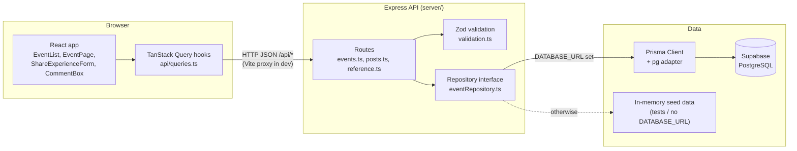
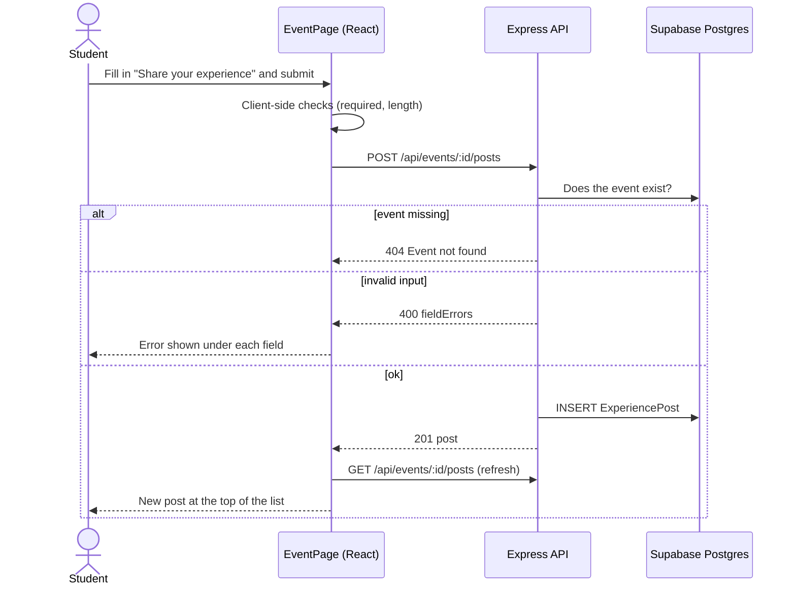

# Architecture

PawSchedule is a single repo (npm workspaces) with two packages:

- **`client/`**: a React + Vite + TypeScript single-page app styled with Tailwind. It talks to the API
  with `fetch` through TanStack Query hooks (`client/src/api/queries.ts`). In development, Vite proxies
  every `/api` request to the API server.
- **`server/`**: an Express + TypeScript REST API. Zod validates every request (`server/src/validation.ts`).
  Routes never touch storage directly. They call a `Repository` interface
  (`server/src/repository/eventRepository.ts`) that has two implementations:
  - `createPrismaRepository`: Prisma Client with the `pg` adapter, connected to **Supabase PostgreSQL**
    through `DATABASE_URL` in `server/.env`.
  - `createJsonRepository`: in-memory seed data, used by the automated tests and whenever
    `DATABASE_URL` isn't set.

## Endpoints

All responses are JSON. A validation error returns `400 { error, fieldErrors }`, and a missing event or
post returns `404 { error }`.

| Method | Path | What it does |
| --- | --- | --- |
| GET | `/api/health` | Health check: `{ "status": "ok" }` |
| GET | `/api/events` | Lists events from now on (or within `from`/`to`), sorted by start, with club name and category. Filters: `category`, `major`, `club`, `campus`, `q`, `from`, `to` |
| POST | `/api/events` | Creates an event (`title`, `clubId`, `start`, `end`, `location`, `campus`, optional `description` and `perks`) |
| GET | `/api/events/:id` | Gets one event |
| GET | `/api/events/:id/posts` | Lists the event's experience posts, newest first, each with its comments |
| POST | `/api/events/:id/posts` | Creates an experience post (`authorName`, `whatIDid`, `whatILearned`) |
| GET | `/api/posts/:id/comments` | Lists a post's comments, oldest first |
| POST | `/api/posts/:id/comments` | Adds a comment (`authorName`, `body`) |
| GET | `/api/categories` | Lists all categories |
| GET | `/api/majors` | Lists all majors |
| GET | `/api/clubs` | Lists clubs, optionally filtered by `category` and `major` |

## Screens

| Path | Screen |
| --- | --- |
| `/` | Upcoming events, with filters (category, major, campus, keyword), the **Add event** form, and a "Went to an event? Share your experience" list of recent past events |
| `/events/:id` | Event page: event details, the **Share your experience** form, and each post with its comments and a comment box |

## Main request flow: sharing an experience

