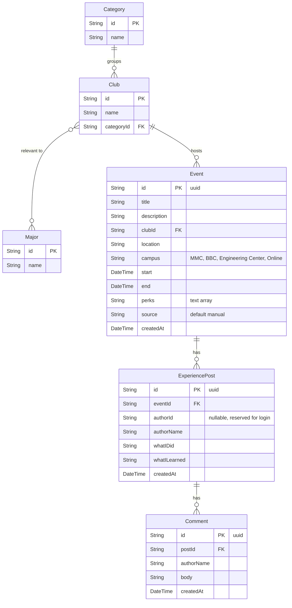

# Data model

The schema lives in [`server/prisma/schema.prisma`](../server/prisma/schema.prisma) and is stored in
PostgreSQL on Supabase. Migrations are in `server/prisma/migrations/`.

## Tables

| Table | What it holds |
| --- | --- |
| **Category** | A type of club (Academic, Cultural, Greek Life, Technology, …), used to filter events. |
| **Major** | An FIU major. It's linked to clubs so students can filter events by their major. |
| **Club** | An FIU student organization. Each club belongs to one category and can be linked to many majors. Prisma stores the club–major link in the implicit `_ClubToMajor` table. |
| **Event** | A club event: title, date and time, location, campus and perks (free food, networking, …). |
| **ExperiencePost** | A student's write-up of an event they went to: what they did and what they learned. |
| **Comment** | A reply from another student on an experience post. |

## Rules

- Deleting an `Event` deletes its posts, and deleting a post deletes its comments (`onDelete: Cascade`).
- Posts are indexed on `(eventId, createdAt)` and comments on `(postId, createdAt)`, which matches how
  the app reads them: all posts for an event, and all comments for a post, in time order.
- There's no login yet, so posts and comments store the author's name. `ExperiencePost.authorId` is
  reserved for linking to a user account later.
- Length limits are enforced by the API (see [requirements.md](requirements.md)), not by the database.
